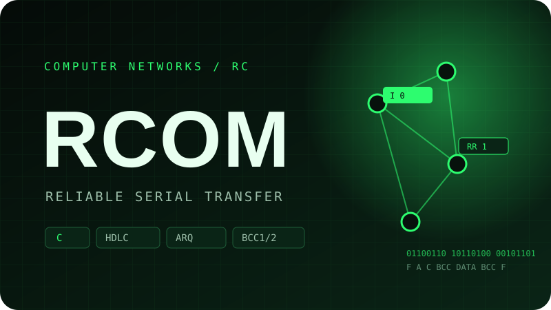
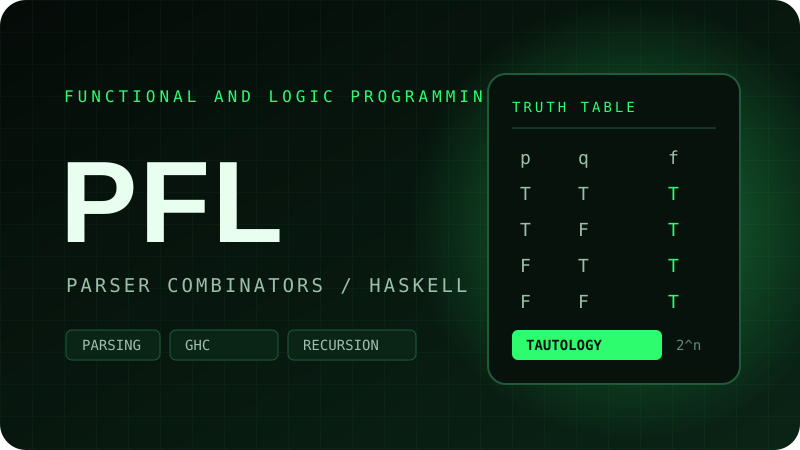
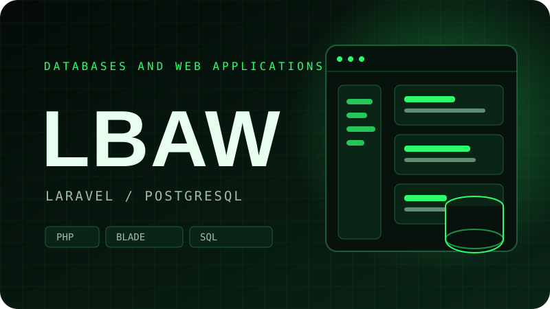
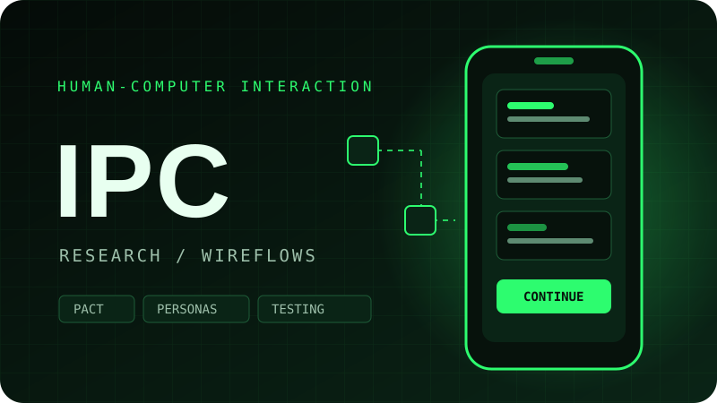
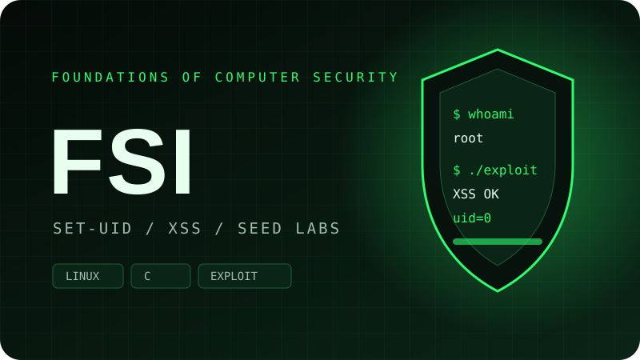
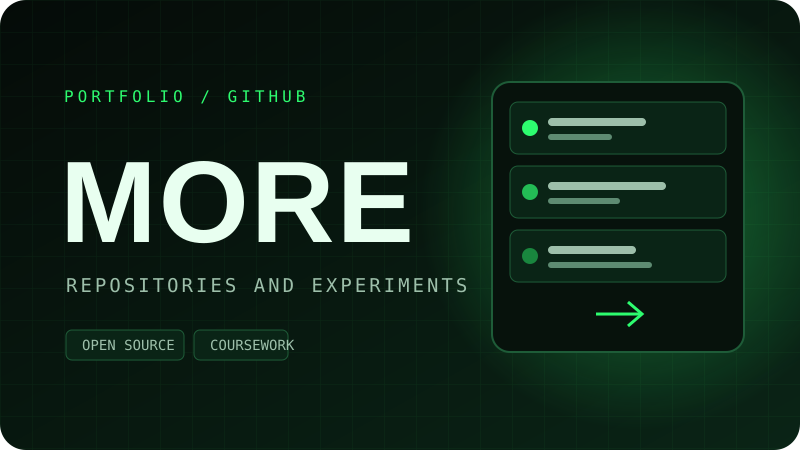

### Hi, I'm Pedro 👋

**Final-year student of Informatics and Computing Engineering (L.EIC) at FEUP** · Porto, Portugal

I build things close to the metal and on the web — from network protocols in C to full-stack applications in Laravel. This page is my portfolio: the projects below are coursework I'm proud of, documented and open to explore.

---

## About me

I'm in my final year of the **Bachelor in Informatics and Computing Engineering (L.EIC)** at the **Faculty of Engineering of the University of Porto (FEUP)**, interested in the layers that make software work: protocols, operating systems, databases and the interfaces people actually use.

My coursework has taken me from **HDLC-style framing and reliable transfer over a serial link in C**, through **parser combinators and truth tables in Haskell**, to a **Laravel + PostgreSQL web platform** and a **user-centred public-services project**. I like code that is correct under failure, documentation that explains *why*, and interfaces that don't make people think.

- 🎓 **Education:** Bachelor in Informatics and Computing Engineering (L.EIC), FEUP — 2026/2027
- 💼 **Open to:** internships and junior software engineering roles
- 🧠 **Currently deepening:** backend engineering, networking and application security
- 📍 **Based in:** Vila Nova de Gaia / Porto, Portugal

---

## Tech stack

**Languages**

**Frameworks & mobile**

**Data & backend**

**Tools & environments**

**Concepts**

`Computer networks` · `Protocol design` · `Operating systems` · `Application security` · `Relational databases & SQL` · `Web application architecture` · `REST APIs` · `Mobile development` · `Human–computer interaction` · `Functional programming` · `Parsing` · `Technical writing`

---

## Featured projects

<table>
  <tr>
    <td width="50%" valign="top">
      
        
      <strong>RCOM — Reliable serial transfer</strong> 
      File transfer over a serial link in C, with HDLC framing, stop-and-wait ARQ and BCC error control.
        
      <a href="https://github.com/putridpunk/RCOM">View project →</a>
    </td>
    <td width="50%" valign="top">
      
        
      <strong>PFL — Logic classifier</strong> 
      Propositional logic parser and truth-table classifier built with parser combinators in Haskell.
        
      <a href="https://github.com/putridpunk/PFL-project-1">View project →</a>
    </td>
  </tr>
  <tr>
    <td width="50%" valign="top">
      
        
      <strong>LBAW — Project management</strong> 
      Collaborative project-management platform built with Laravel, PostgreSQL and Blade.
        
      Available on request
    </td>
    <td width="50%" valign="top">
      
        
      <strong>IPC — Public services app</strong> 
      User-centred app for FEUP administrative procedures, from research and PACT to wireflows.
        
      Available on request
    </td>
  </tr>
  <tr>
    <td width="50%" valign="top">
      
        
      <strong>FSI — Security labs</strong> 
      Hands-on SEED Labs on Set-UID privilege escalation and stored XSS attacks.
        
      Available on request
    </td>
    <td width="50%" valign="top">
      
        
      <strong>More on GitHub</strong> 
      Browse the rest of my repositories, coursework and experiments.
        
      <a href="https://github.com/putridpunk?tab=repositories">Browse repositories →</a>
    </td>
  </tr>
</table>

---

## GitHub in numbers

 

---

## Education

**Faculty of Engineering, University of Porto (FEUP)** — Porto, Portugal 
**Bachelor in Informatics and Computing Engineering (L.EIC)** · 2026/2027 (final year)

A 3-year, 180-ECTS first-cycle degree offered jointly by **FEUP** and the **Faculty of Sciences of the University of Porto (FCUP)**.

**Coursework (3rd year, 1st semester)**

- **Redes de Computadores (RC)** — Computer Networks
- **Laboratório de Bases de Dados e Aplicações Web (LBAW)** — Databases and Web Applications Laboratory
- **Fundamentos de Segurança Informática (FSI)** — Foundations of Computer Security
- **Programação Funcional e em Lógica (PFL)** — Functional and Logic Programming
- **Interação Pessoa-Computador (IPC)** — Human–Computer Interaction

Earlier coursework includes programming fundamentals, discrete mathematics, computer systems fundamentals, algorithms and data structures.

---

## Let's talk

I'm looking for an internship or junior role where I can work on backend systems, infrastructure, AI or security — and keep learning from people who care about doing it properly.

Thanks for stopping by — feel free to explore the repositories above.

