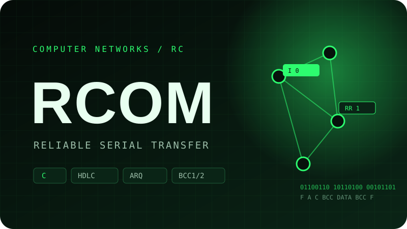
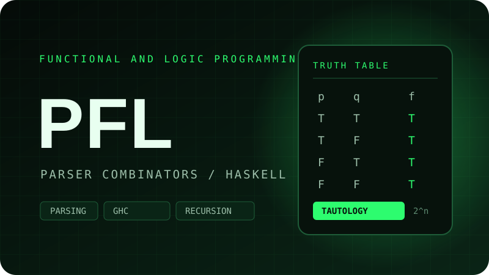
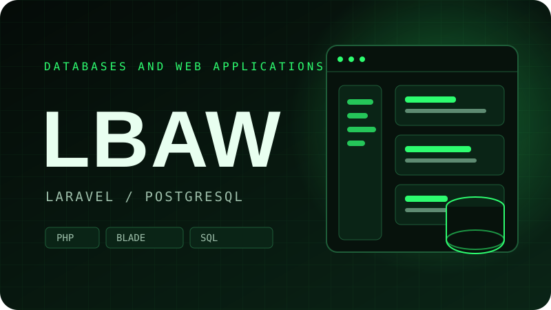
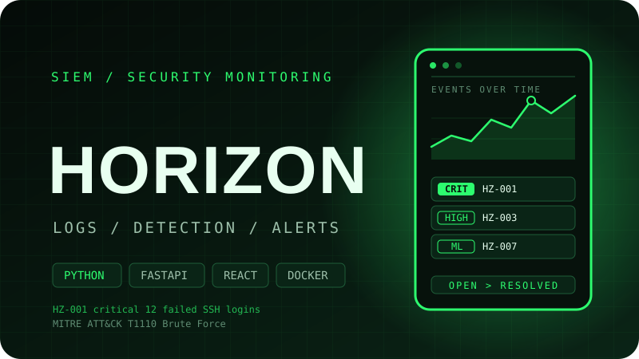
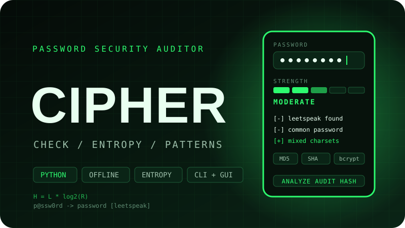
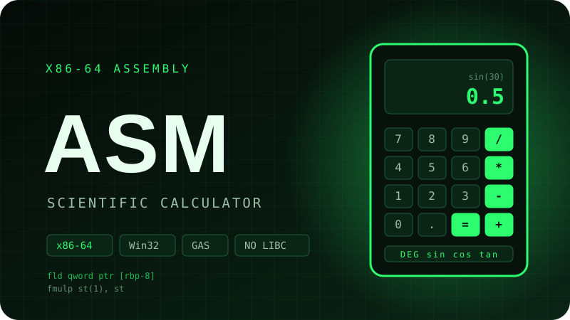
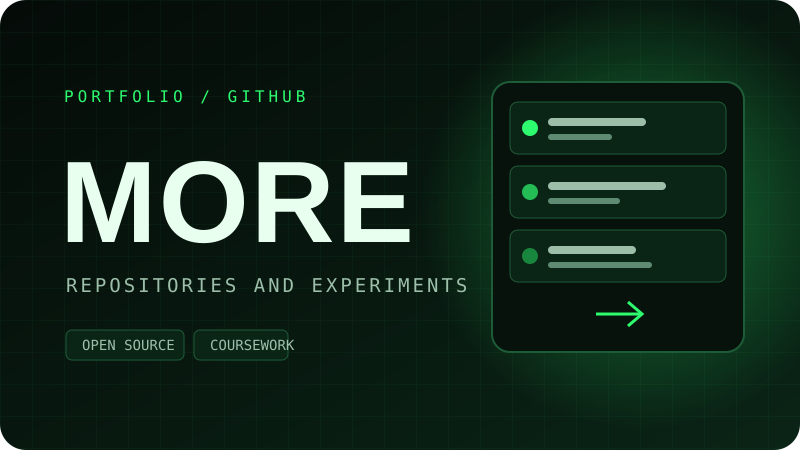

### Hi, I'm Pedro 👋

**Final-year Informatics and Computing Engineering (L.EIC) student at FEUP** · Porto, Portugal

Low-level networking in C, functional programming in Haskell, and full-stack web in Laravel + PostgreSQL. **Looking for an internship or junior role in backend, networking or security.**

---

## About me

I'm in my final year of the **Bachelor in Informatics and Computing Engineering (L.EIC)** at the **Faculty of Engineering of the University of Porto (FEUP)**. I'm interested in the layers that make software work: protocols, operating systems, databases and the interfaces people actually use.

This page collects my coursework. Some projects are public on GitHub; others are still in progress and live in my faculty GitLab until they are ready to show.

- 🎓 **Education:** Bachelor in Informatics and Computing Engineering (L.EIC), FEUP — 2026/2027
- 💼 **Open to:** internships and junior software engineering roles
- 🧠 **Currently deepening:** backend engineering, computer networks and application security
- 📍 **Based in:** Vila Nova de Gaia / Porto, Portugal

---

## Featured projects

<table>
  <tr>
    <td width="50%" valign="top">
      
        
      <strong>RCOM — Reliable serial transfer + FTP client</strong> 
      <em>C · POSIX · termios</em>  
      <strong>Lab 1:</strong> file transfer over a serial link. A link layer with framing, byte stuffing, BCC error control and timeout-based retransmission (<code>alarm</code>/<code>SIGALRM</code>), plus an application protocol of START/DATA/END packets. Includes self-tests for the framing helpers. 
      <strong>Lab 2:</strong> an FTP download client and network configuration experiments.
        
      <a href="https://github.com/putridpunk/RCOM">Code →</a> · <a href="https://github.com/putridpunk/RCOM/blob/HEAD/lab1/relatorio/Lab1_Report.pdf">Lab 1 report (PDF) →</a>
    </td>
    <td width="50%" valign="top">
      
        
      <strong>PFL — Logical calculator</strong> 
      <em>Haskell · parser combinators</em>  
      Parser and evaluator for propositional logic expressions, built from a small set of parser combinators, with additional local test cases (including whitespace handling).
        
      <a href="https://github.com/putridpunk/PFL-project-1">Project 1 →</a> · <a href="https://github.com/putridpunk/PFL-project-2">Project 2 →</a>
    </td>
  </tr>
  <tr>
    <td width="50%" valign="top">
      
        
      <strong>LBAW — Project management platform</strong> 
      <em>Laravel 12 · PostgreSQL 16 · Blade · Docker</em>  
      Collaborative project-management web application: relational schema design, Eloquent models and server-rendered Blade interface.
        
      🚧 In progress — hosted on FEUP GitLab, will be published here when finished.
    </td>
    <td width="50%" valign="top">
      
        
      <strong>Horizon Events — Lightweight SIEM</strong> 
      <em>Python · FastAPI · SQLAlchemy · React · Docker</em>  
      Imports Linux and Windows logs, normalises them into one event format and runs rule-based detections (plus an anomaly model) mapped to MITRE ATT&amp;CK. Alerts and incidents are tracked with a full history and shown in a dashboard. CI on GitHub Actions; all bundled data is synthetic.
        
      <a href="https://github.com/putridpunk/Horizon-Events">View project →</a>
    </td>
  </tr>
  <tr>
    <td width="50%" valign="top">
      
        
      <strong>CipherCheck — Password security auditor</strong> 
      <em>Python · tkinter · CLI</em>  
      Rates password strength with pattern-aware entropy estimation, dictionary and leetspeak detection, and identifies hash formats. Runs fully offline, exports TXT/JSON/HTML reports, ships as a Windows app in 9 languages and has automated tests.
        
      <a href="https://github.com/putridpunk/CipherCheck">View project →</a>
    </td>
    <td width="50%" valign="top">
      
        
      <strong>Assembly Calculator</strong> 
      <em>x86-64 assembly · Win32 API · GNU assembler</em>  
      Scientific calculator written entirely in assembly: expression parser, math engine, number formatter and native Windows GUI, with no C runtime. Supports powers, roots, logarithms, trigonometry (DEG/RAD) and factorials, and includes engine tests.
        
      <a href="https://github.com/putridpunk/Assembly-Calculator">View project →</a>
    </td>
  </tr>
  <tr>
    <td width="100%" valign="top" colspan="2" align="center">
      
        
      <strong>More on GitHub</strong> · Browse all my public repositories.
        
      <a href="https://github.com/putridpunk?tab=repositories">Browse repositories →</a>
    </td>
  </tr>
</table>

---

## Tech stack

**Where I've built real projects**

**Also used in coursework and smaller exercises**

**Concepts:** `Computer networks` · `Protocol design` · `Operating systems` · `Application security` · `Relational databases & SQL` · `Web application architecture` · `Human–computer interaction` · `Functional programming` · `Parsing` · `Technical writing`

---

## GitHub in numbers

 

---

## Education

**Faculty of Engineering, University of Porto (FEUP)** — Porto, Portugal 
**Bachelor in Informatics and Computing Engineering (L.EIC)** · 2026/2027 (final year)

A 3-year, 180-ECTS first-cycle degree offered jointly by **FEUP** and the **Faculty of Sciences of the University of Porto (FCUP)**.

**Coursework (3rd year, 1st semester)**

- **Redes de Computadores (RC)** — Computer Networks → [RCOM](https://github.com/putridpunk/RCOM)
- **Laboratório de Bases de Dados e Aplicações Web (LBAW)** — Databases and Web Applications Laboratory
- **Fundamentos de Segurança Informática (FSI)** — Foundations of Computer Security
- **Programação Funcional e em Lógica (PFL)** — Functional and Logic Programming → [Project 1](https://github.com/putridpunk/PFL-project-1), [Project 2](https://github.com/putridpunk/PFL-project-2)
- **Interação Pessoa-Computador (IPC)** — Human–Computer Interaction

Earlier coursework includes programming fundamentals, discrete mathematics, computer systems fundamentals, algorithms and data structures.

---

## Let's talk

I'm looking for an internship or junior role where I can work on backend systems, networking or security, and keep learning from people who care about doing it properly.

